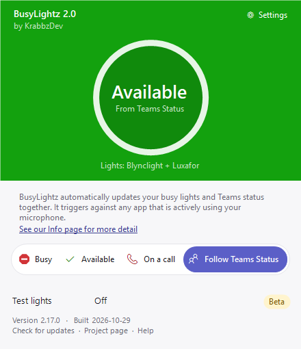

# KrabbzDev-BusyLightz2.0

**One app for your [Embrava Blynclight](https://embrava.com) and [Luxafor Flag](https://luxafor.com) busy lights, together.**

A small Windows tray app that controls USB busy lights directly over USB, so the people around you can see at a glance whether you're free, busy or on a call. Plug in any mix of Blynclights and Luxafor Flags, as many of each as you like, and they all show the same color at the same time. It replaces both Embrava Connect and Luxafor's own app. No vendor accounts or admin rights needed.

📖 **[User guide](docs/README.md)**: every feature and how to use it.

## Why I made this

> The reason I made this app, is I wanted an app to turn my lights red anytime I was on a call. Be it Zoom, Cytracom, Loom, Teams etc. If My MIC is hot, I want the lights red.
>
> — KrabbzDev

## ⬇️ [Download the installer (latest version)](https://github.com/krabbzdev/KrabbzDev-BusyLightz2.0/releases/latest/download/KrabbzDev-BusyLightz2.0.msi)

Release notes and older versions: [Releases](https://github.com/krabbzdev/KrabbzDev-BusyLightz2.0/releases)

If BusyLightz saves you a few interruptions, you can [buy me a coffee](https://buymeacoffee.com/krabbzdev).

## Features

### Your lights

- **Blynclight and Luxafor Flag together:** every connected light shows the same color, and lights plugged in later are matched within seconds. The window shows what's connected, e.g. *Lights: Blynclight + 2 Luxafor*.
- **Four modes, one click each:** **Busy** (red), **Available** (green), **On a call** (flashing red and blue, for calls the app can't detect, like a desk phone) and **Follow Teams Status**. Pick them from the window, the tray menu, or anywhere with the hotkeys `Alt+R` (Busy) and `Alt+G` (Available).
- **Override timer:** Busy, Available and On a call go back to Follow Teams Status on their own after 15 minutes, so you never forget one is on. Choose 5 minutes to 4 hours, or turn it off, in Settings. While an override is on, the window shows a countdown and the tray icon gets a small badge.
- **Three window styles:** **Orbit** (the default, shown above), **Color block** and **Fluent list**, each in Light or Dark mode.
- **Test lights:** cycles smoothly through every color on every light, to check they all work and match.
- **Off:** turns the lights off.

### Calls

- **Flashes whenever you're on a call:** any app using your microphone (Teams, Zoom, Cytracom, Loom, a browser call and so on) sets the lights flashing red and blue, or steady red if you prefer, then back afterwards.
- **Ignore list:** recorders, noise-cancelling tools and other apps that use the mic without a call can be ignored.

### Microsoft Teams

Connect once with a browser sign-in to your work account. No client secret is stored, and the sign-in is encrypted to your Windows account.

- **Follow Teams status:** green Available, red Busy or In a call, purple Do not disturb, yellow Away, off when Offline.
- **Teams matches what you pick:** picking Busy or On a call sets your Teams status to Busy, Available sets it to Available, and going back to Follow Teams Status returns it to normal.
- **Busy in Teams during other calls:** during a Zoom, Cytracom or other non-Teams call, Teams shows you as *Busy, In a call*.
- **Status message while your lights are red:** shows *On a video call* (the default), *In a meeting*, *On a phone call*, *Heads down, please message me*, *Back in a few minutes*, or your own message next to your name in Teams. Your earlier message comes back afterwards.

### Setup and updates

- **Setup checklist** on first run, including setting up the Teams app for your organization.
- **Light or Dark mode**, picked in Settings (Light is the default).
- **Settings window** (⚙ in the app or tray menu): window style, appearance, startup, notifications, hotkeys, override timer, automatic updates, call detection and the Teams options.
- **Notifications** when the lights change.
- **Automatic, silent updates** from this repo's Releases, checked against GitHub's SHA-256 digest before installing, with a card afterwards listing what changed.
- Starts at sign-in and lives in the system tray, with an icon that matches the lights.

## Install

Run the downloaded `KrabbzDev-BusyLightz2.0.msi`. It installs just for you, with no admin prompt, and starts with Windows. The **Setup checklist** walks you through the rest. The installer isn't code-signed yet, so Windows may show an "unknown publisher" warning: click **More info > Run anyway**.

Updates install themselves silently. Details, IT deployment and uninstalling: [Installing and Updating](docs/Installing-and-Updating.md).

Windows doesn't let installers pin apps to the Start menu. Pin it yourself (right-click the Start menu entry → **Pin to Start**), or push a Start pins policy through Intune/Group Policy on managed machines.

## Guide

| Page | What's in it |
| --- | --- |
| [Installing and Updating](docs/Installing-and-Updating.md) | Download, install, automatic updates, uninstall, deploying to many PCs |
| [Using the Light](docs/Using-the-Light.md) | Supported lights, the window, override timer, tray menu, hotkeys, notifications, Settings |
| [Teams Status](docs/Teams-Status.md) | Connecting to Teams, what each color means, Busy in Teams, status messages |
| [Call Detection](docs/Call-Detection.md) | How the lights know you're on a call, ignoring apps |
| [Setup Checklist](docs/Setup-Checklist.md) | Every step of the checklist explained |
| [Setting Up Teams for Your Organization](docs/Setting-Up-Teams-for-Your-Organization.md) | One-time steps for an IT admin |
| [Troubleshooting and FAQ](docs/Troubleshooting-and-FAQ.md) | Common problems and questions |
| [For Developers](docs/For-Developers.md) | Building, publishing releases, project layout, light protocols |
